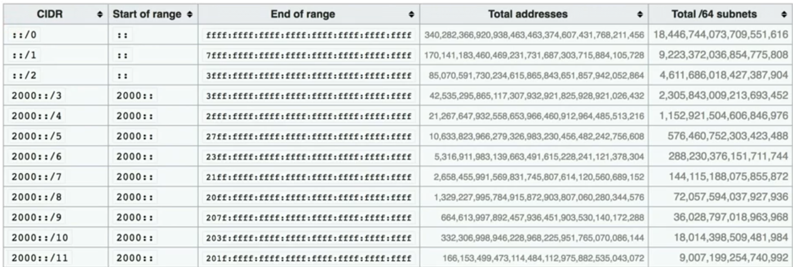

# IPv6

## IPv4 x IPv6

| Característica      | IPv4                          | IPv6                                         |
|---------------------|-------------------------------|----------------------------------------------|
| Tamanho             | 32 bits                       | 128 bits                                     |
| Blocos              | 4 blocos de 8 bits (decimal)  | 8 blocos de 16 bits (hexadecimal)            |
| Separador           | `.`                           | `:`                                          |
| Exemplo             | `192.168.0.1`                 | `2001:db8:85a3::8a2e:370:7334`               |
| Total de endereços  | 2³² = 4.294.967.296 (~4,3 bi) | 2¹²⁸ ≈ 340 undecilhões                       |
| Broadcast           | Sim                           | **Não** (usa multicast)                      |
| Configuração        | Manual ou DHCP                | Manual, DHCPv6 ou **SLAAC** (automática)     |
| Resolução de MAC    | ARP                           | NDP (Neighbor Discovery Protocol)            |
| NAT                 | Quase sempre necessário       | Em geral desnecessário (endereços de sobra)  |

O número exato de endereços IPv6 é **340.282.366.920.938.463.463.374.607.431.768.211.456**. Dá mais de 10²⁸ endereços para cada pessoa no planeta.

## Estrutura do endereço

- 128 bits divididos em **8 blocos** (também chamados de *hextetos*) de **16 bits**.
- Cada bloco é escrito com **4 dígitos hexadecimais**, separados por `:`.

Exemplo:

```
2001:0db8:85a3:0000:0000:8a2e:0370:7334
 |    |    |    |    |    |    |    |
 8 blocos x 16 bits = 128 bits
```

## Números hexadecimais

O sistema hexadecimal tem **16 símbolos**: os dígitos `0 1 2 3 4 5 6 7 8 9` e as letras `A B C D E F`.

| Hex | A  | B  | C  | D  | E  | F  |
|-----|----|----|----|----|----|----|
| Dec | 10 | 11 | 12 | 13 | 14 | 15 |

- Cada dígito hexadecimal representa **4 bits**. Por isso 1 bloco = 4 dígitos = 16 bits.
- Maiúsculas e minúsculas são equivalentes (`1F12` = `1f12`). A forma recomendada (RFC 5952) é **minúscula**.

```
Hex:     F    F    0    A
Binário: 1111 1111 0000 1010
```

Para converter um dígito: `F` = 15 = `1111`, `A` = 10 = `1010`, `0` = `0000`.

## Regras de abreviação

### 1. Omitir zeros à esquerda de cada bloco

```
2001:0db8:0000:0042:0000:8a2e:0370:7334
2001:db8:0:42:0:8a2e:370:7334
```

### 2. Substituir blocos consecutivos de zeros por `::`

Quando houver vários blocos `0000` seguidos, eles podem ser resumidos em `::`.

```
1F12:0000:0000:0000:0000:0000:0000:0001  ->  1F12::0001  ->  1F12::1
```

**Atenção:**

- O `::` só pode aparecer **uma vez** no endereço. Se aparecesse duas, não haveria como saber quantos zeros cada uma representa.
- `::` representa **um ou mais** blocos de zeros (não precisa ser 2 ou mais).
- Se houver dois trechos de zeros, abrevia-se o **maior** (e, em caso de empate, o primeiro).

```
2001:0db8:0000:0000:0001:0000:0000:0001
2001:db8::1:0:0:1        (correto: abrevia o primeiro trecho)
2001:db8::1::1           (INVÁLIDO: dois "::")
```

### Como voltar à forma completa

Conte os blocos que aparecem. A diferença até 8 é o número de blocos `0000` que o `::` escondia:

```
2001:db8::1   ->  tem 3 blocos (2001, db8, 1)  ->  faltam 5 blocos de zeros
              ->  2001:0db8:0000:0000:0000:0000:0000:0001
```

## Prefixo e CIDR

O IPv6 usa a **notação CIDR**, igual ao IPv4: `endereço/tamanho-do-prefixo`. Não existe máscara em decimal (`255.255.x.x`); só se usa `/n`.

```
2001:db8:abcd:0012::/64

|---- prefixo de rede (64 bits) ----|--- ID da interface (64 bits) ---|
 2001:0db8:abcd:0012                  0000:0000:0000:0000
```

- O **prefixo** é a parte da rede (os `n` primeiros bits).
- O restante é o **ID da interface** (o host).
- Um endereço com prefixo `/n` tem `2^(128 − n)` endereços.
- **`/64` é o padrão para uma sub-rede**. Sem ele, recursos como SLAAC não funcionam.
- Um provedor normalmente entrega ao cliente um bloco **`/48`** (empresas) ou **`/56`** (residências). Dentro de um `/48` cabem 2¹⁶ = 65.536 sub-redes `/64`.



A tabela da imagem mostra quantos endereços e quantas sub-redes `/64` cabem em cada prefixo. Exemplos:

| Prefixo | Endereços                     | Sub-redes /64 |
|---------|-------------------------------|---------------|
| `/0`    | 2¹²⁸ (todo o espaço)          | 2⁶⁴           |
| `/3`    | 2¹²⁵ (`2000::/3`, o unicast global) | 2⁶¹     |
| `/48`   | 2⁸⁰                           | 2¹⁶ = 65.536  |
| `/56`   | 2⁷²                           | 2⁸ = 256      |
| `/64`   | 2⁶⁴                           | 1             |
| `/128`  | 1 (um único host)             | -             |

Cada bit a mais no prefixo **divide o espaço pela metade**. Veja na imagem como `/0` → `/1` → `/2` reduz os totais à metade a cada linha.

## Tipos de endereço

O IPv6 **não tem broadcast**. Os tipos são:

- **Unicast:** um host para um host.
- **Multicast:** um host para um grupo (substitui o broadcast).
- **Anycast:** um endereço atribuído a vários hosts, e o pacote vai para o **mais próximo** (usado em DNS e CDNs).

### Blocos principais

| Prefixo         | Nome                  | Equivalente IPv4          | Descrição |
|-----------------|-----------------------|---------------------------|-----------|
| `::1/128`       | Loopback              | `127.0.0.1`               | A própria máquina. |
| `::/128`        | Não especificado      | `0.0.0.0`                 | Host sem endereço ainda. |
| `::/0`          | Rota padrão           | `0.0.0.0/0`               | Rota default. |
| `2000::/3`      | Global unicast        | IP público                | Roteável na internet. Hoje começa com `2` ou `3`. |
| `fc00::/7`      | Unique local (ULA)    | `10.0.0.0/8` etc.         | Privado, usado dentro da organização. Na prática, `fd00::/8`. |
| `fe80::/10`     | Link-local            | `169.254.0.0/16`          | Válido só no segmento local. Toda interface tem um. |
| `ff00::/8`      | Multicast             | `224.0.0.0/4`             | Grupos de hosts. |
| `2001:db8::/32` | Documentação          | -                         | Reservado para exemplos e manuais. Nunca é roteado. |

Diferença importante em relação ao IPv4: no IPv6, uma interface costuma ter **vários endereços ao mesmo tempo**: um link-local (`fe80::`), um ou mais globais e, às vezes, um ULA.

### Multicast mais comuns

| Endereço  | Alcance                     |
|-----------|-----------------------------|
| `ff02::1` | Todos os nós do link (faz o papel do broadcast) |
| `ff02::2` | Todos os roteadores do link |

## Configuração automática

- **SLAAC (Stateless Address Autoconfiguration):** o roteador anuncia o prefixo (mensagens *Router Advertisement*) e o host monta sozinho o próprio endereço: prefixo `/64` + ID da interface. Não precisa de servidor DHCP.
- **DHCPv6:** atribui endereço e outras opções (como DNS) de forma centralizada, como no IPv4.
- **ID da interface:** pode ser aleatório (padrão atual, por **privacidade**) ou derivado do MAC (EUI-64, que expõe o hardware e é menos usado hoje).

## Outras diferenças em relação ao IPv4

- **Cabeçalho simplificado:** tamanho fixo de 40 bytes, sem checksum e sem campos opcionais no cabeçalho principal. Roteadores processam mais rápido.
- **Sem fragmentação em roteadores:** só o host de origem fragmenta (usa Path MTU Discovery).
- **NDP no lugar do ARP:** usa mensagens ICMPv6 para descobrir vizinhos e roteadores.
- **ICMPv6 é essencial:** bloquear todo o ICMPv6 no firewall **quebra** o IPv6.
- **Fim do NAT como necessidade:** cada dispositivo pode ter um endereço global. Isso devolve a conectividade ponta a ponta, mas **NAT não é firewall**, então é preciso continuar filtrando o tráfego de entrada.
- **IPsec** tem suporte nativo no projeto do protocolo.

## Transição IPv4 → IPv6

| Técnica        | Como funciona |
|----------------|---------------|
| **Dual stack** | O dispositivo roda IPv4 e IPv6 ao mesmo tempo. É a mais comum. |
| **Túnel**      | Pacotes IPv6 viajam encapsulados dentro de IPv4 (6in4, 6to4). |
| **NAT64/DNS64**| Permite que hosts só com IPv6 acessem servidores só com IPv4. |

## Resumo rápido

- 128 bits, 8 blocos de 16 bits, em hexadecimal, separados por `:`.
- Omitir zeros à esquerda de cada bloco; `::` **uma única vez** para blocos de zeros seguidos.
- Notação sempre em CIDR; sub-rede padrão `/64`.
- Sem broadcast: usa multicast (`ff02::1`).
- `::1` loopback, `fe80::/10` link-local, `2000::/3` global, `fc00::/7` privado (ULA).
- Configuração automática por SLAAC.
